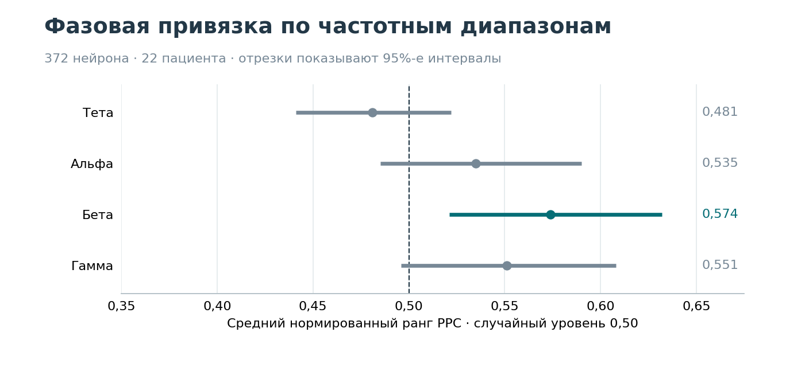
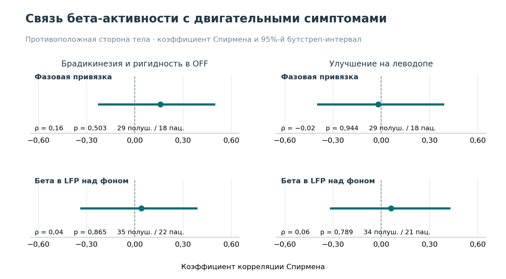

# Связь активности субталамического ядра с двигательными симптомами при болезни Паркинсона

В работе проанализированы записи активности субталамического ядра у 22 пациентов с болезнью Паркинсона. По этим записям оценивались два показателя — сила привязки спайков отдельных нейронов к фазе бета-ритма и выраженность бета-ритма в потенциале локального поля (LFP). Для каждого показателя проверялась связь с суммарным баллом брадикинезии и ригидности и с изменением этого балла после приёма леводопы.

**Основной результат.** У 13 из 372 нейронов выявлена статистически значимая привязка спайков к фазе бета-ритма после поправки на множественные сравнения. Эти нейроны зарегистрированы у 9 пациентов. В исследованной выборке ни сила фазовой привязки, ни выраженность бета-ритма в LFP не показали статистически значимой связи с тяжестью брадикинезии и ригидности или со степенью их улучшения после приёма леводопы.

[ноутбук с анализом](analysis.ipynb)

## Данные

- Фазовый анализ охватывает 372 нейрона из 183 файлов у 22 пациентов.
- Клинические баллы сопоставлялись с полушарием на противоположной стороне от оцениваемых конечностей. Например, запись слева сопоставлялась с симптомами справа.
- Для оценки фазовой привязки учитывались полушария с тремя или более нейронами. Для оценки бета-активности самого LFP использовались доступные записи каждого полушария. Размер выборки для каждого сравнения приведён в таблице.

## Как получены два показателя

**Фазовая привязка спайков.** Для каждого спайка определялась фаза LFP. Согласованность этих фаз оценивалась с помощью pairwise phase consistency (PPC). Затем весь ряд спайков циклически сдвигался относительно LFP, и для каждого сдвига PPC рассчитывалась ещё раз. Нормированный ранг — положение наблюдаемой PPC среди значений от 500 случайных сдвигов. Ранг около 0,9 означает, что примерно 90% сдвигов дали меньшую PPC. Значение 0,5 соответствует середине распределения. В групповом анализе ранги усреднялись по нейронам. Для сравнения с клиникой средний ранг вычислялся внутри каждого полушария.

**Бета-активность LFP.** Для каждой записи методом Уэлча оценивался спектр мощности. Спектральный фон аппроксимировался прямой в логарифмических координатах в диапазоне 4–80 Гц с исключением интервалов 13–30 и 45–55 Гц. Из десятичного логарифма мощности вычиталась оценка фона. Разность усреднялась по бета-диапазону 13–30 Гц. Значения отдельных файлов объединялись медианой внутри полушария.

## Фазовая привязка в группе



Средний ранг в бета-диапазоне составил **0,574** при случайном уровне 0,5 (95%-й иерархический бутстреп-интервал 0,521–0,632). После коррекции FDR по четырём полосам групповой эффект сохранился только в бете (p = 0,0072, q = 0,0288). При отдельной проверке каждого нейрона бета-привязка сохранилась после FDR у **13 из 372 нейронов**, зарегистрированных у **9 пациентов**. 

## Два клинических результата

Для каждого полушария нейрофизиологический показатель сопоставлялся с клинической оценкой на противоположной стороне тела. Связь оценивалась с помощью коэффициента корреляции Спирмена. При расчёте бутстреп-интервалов повторная выборка проводилась по пациентам, чтобы полушария одного человека оставались вместе.



| Показатель | Клинический исход на противоположной стороне тела | Полушария / пациенты | ρ Спирмена | 95%-й ДИ | p до поправки |
|:---:|:---:|:---:|:---:|:---:|:---:|
| Средний ранг фазовой привязки | Брадикинезия + ригидность в OFF | 29 / 18 | +0,16 | −0,23…+0,50 | 0,503 |
| Средний ранг фазовой привязки | Относительное улучшение на леводопе | 29 / 18 | −0,02 | −0,40…+0,39 | 0,944 |
| Бета в LFP над фоном | Брадикинезия + ригидность в OFF | 35 / 22 | +0,04 | −0,34…+0,39 | 0,865 |
| Бета в LFP над фоном | Относительное улучшение на леводопе | 34 / 21 | +0,06 | −0,32…+0,43 | 0,789 |

OFF — оценка симптомов до приёма леводопы, ON — после её приёма. Доля улучшения рассчитывалась как (балл OFF − балл ON) / балл OFF. Отрицательное значение означает, что после приёма леводопы балл вырос.

## Запуск

Выполни команды из папки проекта:

```bash
python -m pip install -r requirements.txt
python demo_phase_rank.py
python plot_results.py
```

`demo_phase_rank.py` на синтетической записи рассчитывает нормированный ранг PPC для одного нейрона и выраженность бета-ритма в LFP.

`plot_results.py` строит графики по сводным данным исследования и сохраняет их в папке `results/`.
